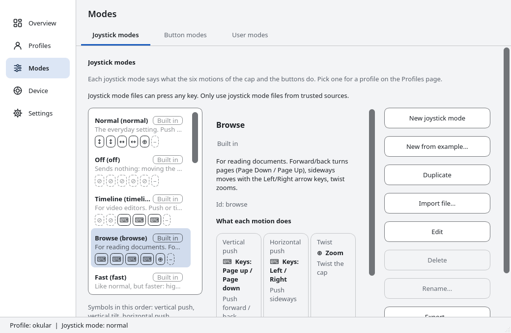

<!-- SPDX-License-Identifier: GPL-3.0-or-later -->
<!-- SPDX-FileCopyrightText: 2026 Lukas Hois-Zelinka -->
# dofscroll

**Use your 3Dconnexion SpaceMouse as a scroll wheel and zoom control in any program.** A SpaceMouse is made for 3D and CAD software; in a web browser, a PDF reader, a map or an office document it usually does nothing. dofscroll turns the six axes into smooth scrolling, zooming and keys for ordinary desktop programs, with per-program and per-device profiles, built-in joystick modes and button modes. Version 1.0.0. Free software for Linux (tested), Windows and macOS (built by CI, never run with a real device, see [Status and testing](#status-and-testing)). Website: <https://hoze-lukas.github.io/dofScroll/> (English, [Deutsch](https://hoze-lukas.github.io/dofScroll/de/)). Wiki: [Quick start](https://github.com/HoZe-Lukas/dofScroll/wiki/Quick-start), [Built-in modes](https://github.com/HoZe-Lukas/dofScroll/wiki/Built-in-modes), [Requirements](https://github.com/HoZe-Lukas/dofScroll/wiki/Requirements).

Install in three lines (download the package from the [latest release](https://github.com/HoZe-Lukas/dofScroll/releases/latest) first; first-time setup in [docs/installation.md](docs/installation.md)):

- **Linux (Fedora, RHEL family; needs EPEL):** `sudo dnf install ./dofscroll-*.rpm`, then `sudo systemctl enable --now spacenavd` and `systemctl --user enable --now dofscroll.service dofscroll-ui.service`. Debian and Ubuntu: `sudo apt install ./dofscroll_*.deb`.
- **Windows:** run the unsigned `dofscroll-*-setup.exe` (SmartScreen: More info, Run anyway) or unpack the portable ZIP.
- **macOS (Apple silicon):** open the unsigned, not notarized DMG and drag the app to Applications (right-click, Open on first start).

dofscroll is not affiliated with or endorsed by 3Dconnexion.

dofscroll turns a 3Dconnexion SpaceMouse into smooth scrolling, zooming, arrow keys and mouse
buttons for ordinary desktop programs. It reads the device through `spacenavd`/`libspnav` and
sends the events through X11 (XTest) or, for Wayland, through uinput.

On **Windows and macOS** the official 3Dconnexion driver can stay installed and running for your CAD
programs. dofscroll then reads the SpaceMouse **through the driver's programming interface when the
driver is installed**, and directly as raw HID otherwise (setting `INPUT`, default `auto`; the
interface shows which one is active). dofscroll contains nothing of the driver: it only loads the
installed driver's interface at run time. The driver, its interface and the names 3Dconnexion and
SpaceMouse belong to 3Dconnexion (a Logitech company); dofscroll is not affiliated with or endorsed
by them. Details: [docs/legal-notes.md](docs/legal-notes.md). The driver path has never been run
against the real driver (see [Status and testing](#status-and-testing)).

It consists of two programs. The Qt interface is the only tray and settings window on Linux, Windows and macOS (the old GTK tray `dofscroll-tray` was removed in 0.1.1, #43):

| Program | Task |
|---|---|
| `dofscroll` | Background daemon. Reads the SpaceMouse, produces the input events. |
| `dofscroll-ui` | Qt6 tray icon and settings window for Linux, Windows and macOS (pages Overview, Profiles with the Channels tab, Joystick modes, Button modes, Device and Axes, Settings). Writes the same config file and tells the daemon to reload. See [docs/ui.md](docs/ui.md). |

## Design principle

dofscroll complements the vendor driver instead of duplicating it: a button mapping that is the same everywhere and always (for example a button that sends Esc) is configured in the driver (spacenavd's spnavrc on Linux, the 3Dconnexion driver on Windows and macOS); dofscroll's own button actions are for bindings that depend on dofscroll's state: they apply only in a joystick mode or profile, switch or toggle joystick modes and behavior, or work together with the axis handling; dofscroll also handles what the driver does not: shaping scroll and zoom from the six axes, keys derived from axes, and per-program and per-device profiles. See [docs/modes.md](docs/modes.md#buttons-and-the-vendor-driver).

## Status and testing

Current stable version: **1.1.2**. Tested extensively only on RHEL 9 (X11, KDE Plasma, SpaceMouse Pro and Compact).
Other Linux distributions were install-tested in CI containers; the Windows and macOS builds are built and
unit-tested by CI but have never been run with a real device.

| Platform | Status |
|---|---|
| RHEL 9, X11, KDE Plasma | **Tested** with the SpaceMouse Pro and the SpaceMouse Compact. |
| Other Linux distributions (Debian, Ubuntu, Fedora, ...) | Not tested with a device. The RPM, DEB and TGZ packages are built and install-tested in CI containers. |
| Linux, Wayland | Not tested. Uses the uinput backend and needs a udev rule that you install yourself (opt-in, see [installation.md](docs/installation.md)); active-window profiles work only with `kdotool` (KDE). |
| Windows | Daemon, Qt interface and an unsigned installer/ZIP are built by CI. **Not run on hardware.** |
| macOS | Daemon, Qt interface and an unsigned, not notarized DMG (Apple silicon) are built by CI. **Not run on hardware.** |

| Device | Status |
|---|---|
| SpaceMouse Pro | Tested (RHEL 9, X11, KDE Plasma). |
| SpaceMouse Compact | Tested (RHEL 9, X11, KDE Plasma). |
| SpaceMouse Wireless, Pro Wireless, Enterprise, SpaceNavigator and other models | Not tested. The factory button count comes from vendor information, see [docs/devices.md](docs/devices.md). |

Automated tests (CI) run on Linux, Windows and macOS runners; they cover logic, not real devices.

### Known limitations

- Windows and macOS: never run with a real device, and the path through the official driver's
  interface has never been run against the real driver (only against a fake driver in CI; hardware
  checklist items in `docs/port-windows-checklist.md` and `docs/port-macos-checklist.md`).
  Whether dofscroll and the driver can read the device at the same time is exactly what is
  unverified. The Windows installer is not code-signed
  (SmartScreen warns) and the macOS DMG is only ad-hoc signed and not notarized (Gatekeeper
  blocks the first start). Notes in [docs/installation.md](docs/installation.md).
- The Qt interface has not been checked on Windows or macOS desktops.
- Pausing output while the own session is not the active one (several users on one PC) was
  unit-tested with fake probes only; no second user session was available. The Windows and macOS
  probes are compile-checked only.
- On Linux `spacenavd` reports one merged device, so two mice with different joystick modes at once are
  not possible there. On Windows and macOS (direct HID) every device has its own profile and joystick mode, one
  device per model; tested with a fake source only ([docs/multi-device.md](docs/multi-device.md)).
- Wayland: not tested; the uinput udev rule is opt-in; active-window profiles need `kdotool`.
- Supported devices: models that `spacenavd` supports (Linux) or that report a known HID layout
  (Windows, macOS); the factory button count is known for SpaceMouse Pro, Pro Wireless, Compact,
  Wireless, Enterprise and SpaceNavigator.

Release notes: [docs/release-notes-1.1.2.md](docs/release-notes-1.1.2.md) (and [1.1.1](docs/release-notes-1.1.1.md), [1.1.0](docs/release-notes-1.1.0.md), [1.0.0](docs/release-notes-1.0.0.md), [beta.2](docs/release-notes-0.1.0-beta.2.md), [beta.1](docs/release-notes-0.1.0-beta.1.md)).

## Download and install

1. Open the [Releases page](https://github.com/HoZe-Lukas/dofScroll/releases)
   (newest stable: [/releases/latest](https://github.com/HoZe-Lukas/dofScroll/releases/latest)).
2. Download the package for your system plus `SHA256SUMS.txt`.
3. Verify: `sha256sum -c --ignore-missing SHA256SUMS.txt`
4. Install: `sudo dnf install ./dofscroll-*.rpm` (RHEL family, needs EPEL) or
   `sudo apt install ./dofscroll_*.deb` (Debian family). The Linux packages contain the Qt interface
   (`dofscroll-ui`) with its own Qt 6.9.3 (no Qt from the system, none from EPEL); only
   `spacenavd` is needed for the device (EPEL on the RHEL family).
   Windows: unsigned `-setup.exe` or portable ZIP (SmartScreen: More info, Run anyway). macOS:
   unsigned DMG (right-click > Open). Details per system: [docs/installation.md](docs/installation.md).
5. Follow the first-time setup in [docs/installation.md](docs/installation.md). The user units
   are not installed where systemd looks for them on every distribution, so do not skip it.

## First run

1. `sudo systemctl enable --now spacenavd`
2. Enable the user services (after the setup step in the installation guide):
   `systemctl --user enable --now dofscroll.service dofscroll-ui.service`
   "Start at login" in the interface switches autostart on and off.
3. Plug in the SpaceMouse. Push the cap: the window under the pointer scrolls. Twist: it zooms
   (Ctrl + scroll).
4. Right-click the tray icon, open "Settings..." and adjust sensitivity, dead zone and direction.
   Changes apply immediately.

If nothing happens, see [docs/troubleshooting.md](docs/troubleshooting.md).

## Documentation

| Document | Content |
|---|---|
| [docs/installation.md](docs/installation.md) | Install from a release, first-time setup, upgrade, uninstall, build from source |
| [docs/ui.md](docs/ui.md) | The Qt interface: pages, profile editor, autosave, inheritance, joystick modes and button modes, running-program picker, tray |
| [docs/configuration.md](docs/configuration.md) | Config file, all keys, profiles, precedence, examples |
| [docs/button-modes.md](docs/button-modes.md) | Button modes: named button behaviors in `buttons/*.conf`, chosen per button |
| [docs/modes.md](docs/modes.md) | Joystick modes, button actions, key names, buttons versus the vendor driver (always-the-same button mappings belong in the driver) |
| [docs/troubleshooting.md](docs/troubleshooting.md) | Common problems, logs, status files |
| [docs/devices.md](docs/devices.md) | Device descriptions |
| [docs/security.md](docs/security.md) | Threat model, systemd hardening, uinput permissions, loading the driver interface |
| [docs/legal-notes.md](docs/legal-notes.md) | What dofscroll uses of the 3Dconnexion driver, what it does not ship, where the rights lie |
| [docs/releasing.md](docs/releasing.md) | How a release is made |
| [docs/release-notes-1.1.2.md](docs/release-notes-1.1.2.md) | Release notes of 1.1.2; 1.1.1 in [docs/release-notes-1.1.1.md](docs/release-notes-1.1.1.md), 1.1.0 in [docs/release-notes-1.1.0.md](docs/release-notes-1.1.0.md), 1.0.0 in [docs/release-notes-1.0.0.md](docs/release-notes-1.0.0.md), 0.1.1 in [docs/release-notes-0.1.1.md](docs/release-notes-0.1.1.md), beta.2 in [docs/release-notes-0.1.0-beta.2.md](docs/release-notes-0.1.0-beta.2.md), beta.1 notes in [docs/release-notes-0.1.0-beta.1.md](docs/release-notes-0.1.0-beta.1.md) |
| [docs/work-plan.md](docs/work-plan.md) | Roadmap and the Windows/macOS ports |
| [CONTRIBUTING.md](CONTRIBUTING.md) | Build, test, pull requests, adding a joystick mode or language |

## Text and encoding

All text is UTF-8: configuration, joystick mode and device files, logs, and every path (spaces, umlauts,
CJK, emoji and characters such as `#` `;` `=` `%` `&` `[` `]` are fine). A BOM is accepted when
reading and never written; case-insensitive matching folds ASCII letters only. Details and limits:
[docs/encoding.md](docs/encoding.md).

## Security notes

- **Joystick mode files are code-like.** A joystick mode file can press any key from the key list (including Ctrl,
  Alt and Super, and chords such as Ctrl+W through the zoom channel) while a button is held or an
  axis is deflected. Only use joystick mode files from sources you trust and read them first: look for
  `key:`, `keys:`, `zoom` and `mode:`. The daemon warns at load time about modifier-capable
  bindings. Details in [docs/modes.md](docs/modes.md#safety-and-sharing-modes). `ENABLED`,
  `BACKEND` and `TICK_HZ` are not allowed in joystick mode files.
- **The uinput udev rule is opt-in.** Packages do not enable `/dev/uinput` access. Only Wayland
  users need it; see [docs/installation.md](docs/installation.md).
- Threat model, hardening and open points: [docs/security.md](docs/security.md).

## Architecture in short

- A reader thread stores the newest raw axis values. The main thread runs a fixed tick
  (`TICK_HZ`, default 250 Hz) and turns them into events, so scrolling is even and does not
  depend on the driver's event rate.
- The daemon pauses its output while its own session is not the active one (several users on one
  PC) and has a safety net that releases keys and buttons it still holds when the device is
  quiet, see [docs/troubleshooting.md](docs/troubleshooting.md).
- The daemon reloads its config on `SIGHUP` and when the file changes. It reconnects to
  `spacenavd` by itself. It never needs root.
- The source code in `src/` is the reference for behavior. The headers are the contracts.

## License and trademarks

dofscroll is licensed under the GNU General Public License, version 3 or (at your option) any
later version (SPDX: `GPL-3.0-or-later`), see [LICENSE](LICENSE). Licenses of the libraries it
builds on are listed in [THIRD-PARTY-NOTICES.md](THIRD-PARTY-NOTICES.md).

"3Dconnexion" and "SpaceMouse" are trademarks of 3Dconnexion GmbH or their respective owners.
dofscroll is an independent project and is neither endorsed by nor affiliated with 3Dconnexion.
The names are used descriptively only, to name the supported hardware.

The official 3Dconnexion driver, its interface and the names belong to 3Dconnexion (a Logitech
company). On Windows and macOS dofscroll uses the driver's interface at run time when the driver
is installed and does not contain, copy or redistribute any of it; no permission was requested
from 3Dconnexion. See [docs/legal-notes.md](docs/legal-notes.md).
